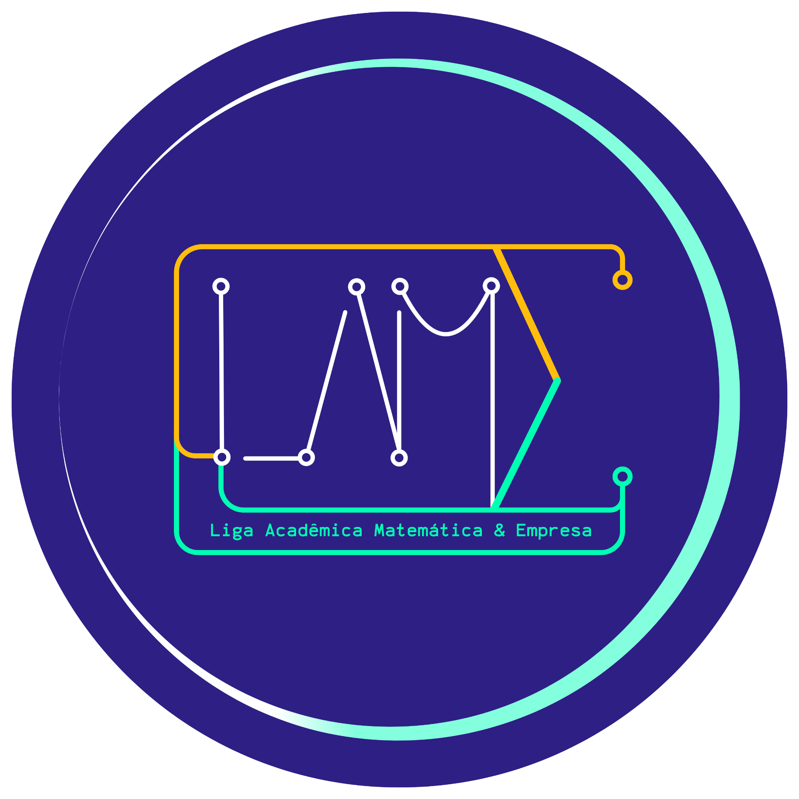

  
  

  <h1>Introdução a Ciência de Dados com Python</h1>
  
<strong>LAME · EMASC 2026 · UFS</strong>

  
25 e 26 de novembro de 2026 · 4 horas

Neste repositório estão os materiais do minicurso promovido pela Liga Acadêmica Matemática & Empresa (LAME). Os materiais reúnem os fundamentos de Python, Estatística, análise e visualização de dados.

## 1. Materiais do minicurso

| Material | Arquivo | Google Colab |
|---|---|---|
| Apresentação do minicurso | [Baixar PDF](https://github.com/lame-ufs/EMASC-2026/raw/refs/heads/main/slides/minicurso-emasc-2026.pdf) | — |
| Guia de Apoio | [Baixar PDF](https://github.com/lame-ufs/EMASC-2026/raw/refs/heads/main/guia-de-apoio/guia_lame.pdf) | — |
| Exemplos do minicurso | [Abrir/baixar notebook (.ipynb)](notebooks/exemplos.ipynb) | [Abrir no Colab](https://colab.research.google.com/github/lame-ufs/EMASC-2026/blob/main/notebooks/exemplos.ipynb) |
| Exercícios | [Abrir/baixar notebook (.ipynb)](notebooks/exercicios.ipynb) | [Abrir no Colab](https://colab.research.google.com/github/lame-ufs/EMASC-2026/blob/main/notebooks/exercicios.ipynb) |

O Guia de Apoio é um material complementar, com explicações e exemplos para consulta após o minicurso. Os exercícios estão organizados em níveis de dificuldade no notebook de exercícios.

### Materiais disponíveis após os exercícios

Os materiais abaixo serão disponibilizados em **26 de novembro de 2026, após a etapa de exercícios**. Os links estarão ativos no GitHub após a liberação.

| Material | Acesso |
|---|---|
| Gabarito dos exercícios | [Notebook (.ipynb)](notebooks/gabarito.ipynb) |
| Proposta do Processo Seletivo LAME 2027 | [PDF](projeto-lame-2027/proposta.pdf) |
| Base de dados do processo seletivo | [CSV](projeto-lame-2027/desperdicio_alimentos.csv) |

A entrega do projeto do processo seletivo deverá ser realizada até **10 de janeiro de 2027**, com o arquivo `.ipynb` anexado ao e-mail da Liga.

## 2. Como executar os notebooks

### Pelo Google Colab (recomendado)

O [Google Colab](https://colab.research.google.com/) permite executar Python pelo navegador, sem instalar os programas no computador.

1. Clique em **Abrir no Colab** na linha do notebook desejado.
2. Acesse sua conta Google, se necessário.
3. Execute cada célula de código na ordem em que aparece, usando o botão de execução ou o atalho `Shift + Enter`. No notebook de exercícios, complete as lacunas antes de executar as células correspondentes.
4. Para guardar as alterações, selecione **Arquivo > Salvar uma cópia no Drive**.

Para baixar o notebook (.ipynb), abra o arquivo pelo link da tabela e clique no ícone de download (**Download raw file**), próximo ao botão **Raw**, no GitHub. O arquivo poderá ser enviado ao Colab pela opção de upload de notebooks.

### Bases de dados

Os exemplos de Estatística e Ciência de Dados carregam as bases automaticamente do GitHub no Colab ou da pasta local do projeto. Os arquivos CSV também estão disponíveis para download.

- [Base de Estatística — alunos_redes_ia.csv](notebooks/alunos_redes_ia.csv): utilizada no notebook de exemplos.
- [Base de notas — notas.csv](guia-de-apoio/dados/notas.csv): utilizada nos exemplos de Ciência de Dados e do Guia de Apoio.
- [Base do Titanic — titanic.csv](notebooks/titanic.csv): utilizada no bloco de Ciência de Dados dos exercícios. Cópia da [base pública do seaborn-data](https://github.com/mwaskom/seaborn-data/blob/master/titanic.csv).

Se for necessário enviar uma base manualmente, abra o arquivo no GitHub e clique em **Download raw file**. No Colab, abra o painel **Arquivos** (ícone de pasta) e envie o CSV, mantendo o nome do arquivo.

Para executar os notebooks no computador, consulte as [instruções de instalação e execução local](notebooks/README.md).

## 3. Como baixar todos os materiais

Para baixar uma cópia completa do repositório:

1. Na página inicial do GitHub, clique no botão verde **Code**.
2. Selecione **Download ZIP**.
3. Extraia o arquivo ZIP em uma pasta do computador.

Os arquivos PDF também podem ser abertos diretamente pelos links da seção de materiais e salvos pelo botão de download do leitor de PDF.

## 4. Cronograma

| Data e horário de início | Atividade | Duração |
|---|---|---:|
| 25/11, quarta-feira, 16h30 | Introdução e motivações | 15 min |
| 25/11 | Introdução ao Python | 60 min |
| 25/11 | Introdução à Estatística | 45 min |
| 26/11, quinta-feira, 16h | Ciência de Dados e Bibliotecas | 50 min |
| 26/11 | Exercícios | 60 min |
| 26/11 | Processo Seletivo LAME 2027 | 10 min |

**Local:** Laboratório de Informática do Departamento de Matemática da UFS.

## 5. Contato

Em caso de dúvidas sobre o minicurso, entre em contato pelo e-mail [lame.ufs.mat@gmail.com](mailto:lame.ufs.mat@gmail.com).

---

Liga Acadêmica Matemática &amp; Empresa · UFS · EMASC 2026

